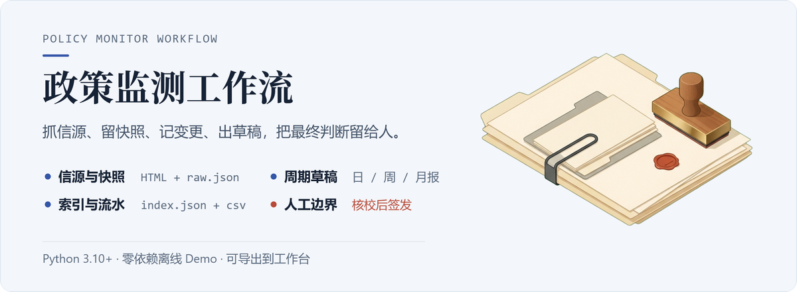

<p align="center">
  
</p>

# Policy Monitor Workflow

**English** | [中文](README.md)

Refreshing government and industry websites by hand every day, pulling out highlights, and writing weekly reports — the hard part is usually not fetching. It is that two weeks later the link is dead, or you cannot remember which item you already reported or whose body text changed.

These scripts run an offline demo with only the Python standard library: fetch the sources, store the original HTML, then generate a stable index, a change log, and daily/weekly/monthly report drafts. Which policy actually matters to the business and how the public wording should read is left entirely to humans.

`Python 3.10+` · `Zero-dependency offline demo` · `MIT / CC BY 4.0 / CC0`

## Run the offline demo first

No third-party libraries and no network needed — just run:

```bash
python scripts/run_pipeline.py --demo
```

The script reads 4 local HTML snapshots, parses **8 fictional items**, and writes a complete set of files under `examples/outputs/`:

```text
examples/outputs/
├── index.json           # consolidated item table (doc_id, title, level, type, date, summary)
├── changes.csv          # added / updated / removed records, UTF-8 BOM, opens directly in Excel
├── daily/2026-11-12.md  # one-page daily report draft
├── weekly/2026-W46.md   # weekly draft (3–5 highlights + deadline calendar)
├── monthly/2026-11.md   # monthly draft (trends + incremental summary)
└── workbench/           # data package for the workbench front end
```

> Demo sample dates are fixed to November 2026, so the output is identical on any machine. To change the base date, add `--date 2026-11-13`.

## Tests

Offline tests use only the standard library:

```bash
python -m unittest discover -s tests -v
python scripts/run_pipeline.py --demo
git diff --exit-code
```

The second command reruns the demo; if anything in `examples/outputs/` changed, the code or templates changed the output, and you need to confirm whether that is an intentional update or a regression. This sequence can go straight into CI.

## How the pipeline works

<p align="center">
  
</p>

1. **Choose sources**: [sources/sources.example.yaml](sources/sources.example.yaml) contains 11 example sources covering common HTML list pages, JSON APIs, RSS, and manual-entry sources.
2. **Save the original**: while fetching the list, keep the detail page's raw HTML, the pre-parse `raw.json`, and the fetch status `health.csv`. Even if the page is deleted or redesigned a few days later, you still have the source.
3. **Build the ledger**: extract the title, document number, issuing agency, publication date, and application deadline into `index.json` and `changes.csv`, along with extraction confidence and warnings.
4. **Assemble drafts**: fill fixed templates for daily, weekly, and monthly reports.

The scripts stop here. Verifying the original, judging relevance, finalizing the copy, and publishing must be done by a human; even with AI-assisted triage, nothing is auto-signed.

## How it differs from a pile of bookmarks

| The old way | After running these scripts |
|---|---|
| Bookmarks accumulate links; two weeks later, 404 | Every fetch keeps a raw HTML snapshot, so the source is still there when the link dies |
| Before writing the weekly report, scroll back through records to recall "what came out this week" | `changes.csv` records additions and changes; drafts list deadlines directly |
| You remember seeing a notice but cannot find where | Every item carries `source_url`, `content_hash`, and `review.required` |
| Sparse fields come back and you cannot tell | Extracted fields carry provenance, confidence, and warnings for focused review |

It is **not** a commercial policy database, nor a general-purpose crawler framework. It only makes the path from collection to draft stable and reproducible.

## What the generated index looks like

`index.json` is designed for humans and front-end pages; full texts are split into `examples/items/`:

```json
{
  "doc_id": "CITY-2026-57699d4f",
  "title": "关于组织开展2026年度示例市智能工厂梯度培育申报工作的通知",
  "level": "市级部门",
  "type": "申报",
  "publish_date": "2026-11-09",
  "deadline": "2026-12-05",
  "status": "待研判",
  "summary": "为加快推动制造业数字化转型……",
  "source_url": "https://jxj.example.gov.cn/...",
  "content_path": "examples/items/CITY-2026-57699d4f.json",
  "review": { "required": true, "reasons": ["核对申报对象、材料清单与截止时间"] }
}
```

Re-running the same URL keeps the same `doc_id`; `review.required` is always `true` by default, reminding humans not to skip verification; each row in `changes.csv` records one change, handy for reviewing a week's activity.

> The field values above come from the Chinese demo data; the schema itself is language-agnostic.

## Export it for the workbench

If you do not want to read plain text files, run one more command after the demo:

```bash
python scripts/export_workbench.py
```

It generates `index.json`, `annotations.json`, `reports.json`, and a `content.md` for each item under `examples/outputs/workbench/` — everything the companion workbench needs. Copy that whole directory into `workbench/` in [agent-workbench-template](https://github.com/Fanghj256/agent-workbench-template), and you can filter, read, and annotate in the sidebar UI.

The workbench only reads these generated files; human judgments go into a separate overlay, so re-exporting next time will not overwrite your annotations. See [docs/workflow.md](docs/workflow.md) for the field mapping.

## Point it at the sites you care about

- **Change the source list**: copy `sources/sources.example.yaml` to `sources/sources.local.yaml` and fill in target URLs, CSS selectors, and keywords.
- **Change taxonomy labels**: edit the topic list under `taxonomy`; it only changes classification labels, never drops a page.
- **Change report style**: edit `templates/*.md` directly; `report.py` only substitutes placeholders.
- **Change time windows**: the date ranges for daily, weekly, and monthly reports live in `select_items` in `report.py`.

Live mode needs `requests` and `PyYAML`:

```bash
cp sources/sources.example.yaml sources/sources.local.yaml
python -m pip install -r requirements.txt
python scripts/run_pipeline.py --config sources/sources.local.yaml
```

Adding sources, health checks, and common troubleshooting are in [docs/sources.md](docs/sources.md); the full data structure is in [docs/architecture.md](docs/architecture.md).

## Boundaries and limitations

- The demo bundled in the repo is entirely fictional and does not represent any real policy.
- Live sites need you to maintain page selectors; the default scripts do not handle JS-rendered pages, login walls, CAPTCHAs, or complex scanned PDFs.
- Dates, document numbers, and deadlines are extracted with rule-based heuristics; always open the original and verify before putting them in formal material.
- Storing the index as JSON is light enough for a person or small team with a few thousand items; beyond that, swap the storage layer for SQLite or Postgres without changing the field structure.
- No scheduling, push notifications, or permission auditing; those belong to an external cron or an existing workflow system.

## Security and licenses

- Credential management, log redaction, and data-retention principles: [SECURITY.md](SECURITY.md).
- Code: MIT ([LICENSE](LICENSE))
- Docs, prompts, and report templates: CC BY 4.0 ([LICENSE-docs](LICENSE-docs))
- Example data: CC0 ([LICENSE-data](LICENSE-data))
- Copyright in fetched public web pages remains with the original publisher; check their site terms, robots policy, and local law before use or redistribution.

---

*Linked docs (except this README) are currently in Chinese.*