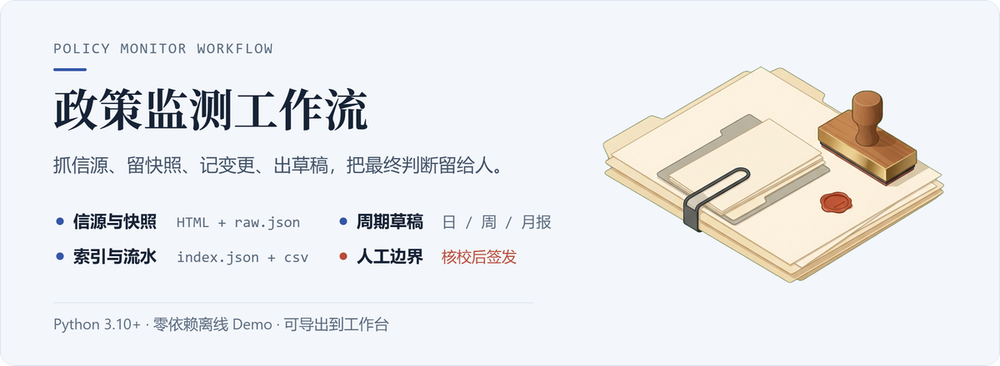

<p align="center">
  
</p>

# 政策监测工作流

每天手工刷各个政务或行业网站、摘重点、写周报，最麻烦的往往不是“抓不到”，而是过两周链接打不开了，或者记不清哪条发过、哪条正文改过。

这套脚本只用 Python 标准库就能跑通离线 Demo：先把信源抓下来、把原始 HTML 存好，再生成稳定的索引、变更流水和日/周/月报草稿。至于哪条政策真正跟业务有关、对外口径怎么写，全部留给人来拍板。

`Python 3.10+` · `零依赖离线 Demo` · `MIT / CC BY 4.0 / CC0`

## 先跑一遍离线 Demo

不用装任何第三方库，也不用联网，直接跑：

```bash
python scripts/run_pipeline.py --demo
```

脚本会读取 4 份本地 HTML 快照、解析出 **8 条虚构条目**，在 `examples/outputs/` 下生成一套完整的文件：

```text
examples/outputs/
├── index.json           # 整理好的条目总表（doc_id、标题、层级、类型、日期、摘要）
├── changes.csv          # 新增 / 更新 / 下线记录，带 UTF-8 BOM，Excel 可直接打开
├── daily/2026-11-12.md  # 1 页日报草稿
├── weekly/2026-W46.md   # 周报草稿（3–5 条重点 + 截止日历）
├── monthly/2026-11.md   # 月报草稿（月度趋势 + 增量汇总）
└── workbench/           # 顺便导出给工作台前端用的数据包
```

> Demo 的样本时间固定在 2026 年 11 月，你在任何机器上跑出的结果都是一样的。想换个基准日期，可以加上 `--date 2026-11-13`。

## 整个流程怎么走

<p align="center">
  
</p>

1. **选定信源**：[sources/sources.example.yaml](sources/sources.example.yaml) 里放了 11 个示例信源，覆盖常见的 HTML 列表页、JSON 接口、RSS 和人工补录源。
2. **存下原文**：抓列表的同时把详情页原始 HTML、解析前的 `raw.json` 和抓取状态 `health.csv` 一起留下来。就算原网页过几天删了或改版了，手头依然有底稿。
3. **整理台账**：抽取标题、发文字号、发文机构、发布日和申报截止日，写成 `index.json` 和 `changes.csv`，顺带标出抽取置信度和异常提示（warnings）。
4. **拼出草稿**：按固定模板套出日报、周报和月报草稿。

脚本走到这里就停了。后面的核对原文、判断相关性、改定稿件再对外发送，必须由人来完成；即使接了 AI 辅助初筛，也不会替人自动签发。

## 和零散收藏夹有什么区别

| 以前的做法 | 跑完这套脚本后 |
|---|---|
| 浏览器收藏夹存一堆链接，过两周 404 | 每次采集都留了原始 HTML 快照，原链接失效也能查 |
| 写周报前翻记录回忆“这周发了啥” | `changes.csv` 记清了新增和改动，草稿里直接列出截止日期 |
| 只记得好像看过某份通知，找不到出处 | 每条自带 `source_url`、`content_hash` 和 `review.required` |
| 抓回来的字段残缺不全还看不出来 | 抽取字段带来源、置信度和 warnings，方便重点复核 |

它**不是**商用政策数据库，也不是通用爬虫框架，只负责把从采集到草稿这一段路走稳、走得可复现。

## 生成的索引长什么样

`index.json` 面向人和前端页面设计，正文内容拆在 `examples/items/` 下：

```json
{
  "doc_id": "CITY-2026-57699d4f",
  "title": "关于组织开展2026年度示例市智能工厂梯度培育申报工作的通知",
  "level": "市级部门",
  "type": "申报",
  "publish_date": "2026-11-09",
  "deadline": "2026-12-05",
  "status": "待研判",
  "summary": "为加快推动制造业数字化转型……",
  "source_url": "https://jxj.example.gov.cn/...",
  "content_path": "examples/items/CITY-2026-57699d4f.json",
  "review": { "required": true, "reasons": ["核对申报对象、材料清单与截止时间"] }
}
```

同一个 URL 多次重跑，`doc_id` 不会变；`review.required` 默认永远是 `true`，提醒人不要跳过核验；`changes.csv` 每行记一次变化，适合拉出来看一周动态。

## 导出给工作台直接看

如果你不想只看纯文本文件，跑完 Demo 后再执行一句：

```bash
python scripts/export_workbench.py
```

它会在 `examples/outputs/workbench/` 生成配套工作台所需的 `index.json`、`annotations.json`、`reports.json` 和每篇正文的 `content.md`。把这一整份目录复制到 [agent-workbench-template](https://github.com/Fanghj256/agent-workbench-template) 的 `workbench/` 下，就能直接在侧栏界面里筛选、阅读和写批注。

工作台只会读取这批生成物，人的研判结果写在单独的覆盖层里，下次重跑脚本导出时不会把写好的批注覆盖掉。字段对应关系见 [docs/workflow.md](docs/workflow.md)。

## 换成你关注的网站

- **改信源列表**：把 `sources/sources.example.yaml` 复制成 `sources/sources.local.yaml`，填上目标网址、CSS 选择器和关键词。
- **改分类标签**：调整 `taxonomy` 里的主题词表，只会改变分类标签，不会漏抓页面。
- **改报告样式**：直接编辑 `templates/*.md`，`report.py` 只做占位符替换。
- **改时间窗口**：日报、周报、月报的统计范围都在 `report.py` 的 `select_items` 里。

跑真实网站（live 模式）需要装 `requests` 和 `PyYAML`：

```bash
cp sources/sources.example.yaml sources/sources.local.yaml
python -m pip install -r requirements.txt
python scripts/run_pipeline.py --config sources/sources.local.yaml
```

新增信源的写法、健康检查和常见排错见 [docs/sources.md](docs/sources.md)，完整数据结构见 [docs/architecture.md](docs/architecture.md)。

## 边界与限制

- 仓库内置的 Demo 全部是虚构示例，不代表任何真实政策。
- 跑真实站点需要自己维护页面选择器；遇到前端 JS 动态渲染、登录拦截、验证码或复杂 PDF 扫描件，默认脚本不处理。
- 日期、文号、截止时间靠规则启发式抽取，写进正式材料前务必点开原文确认一遍。
- 直接用 JSON 存索引，个人或小团队几千条规模足够轻快；再往上扩展建议把存储层换成 SQLite 或 Postgres，字段结构不用改。
- 不含定时调度、消息推送和权限审计，这部分适合交给外部 cron 或已有工作流系统。

## 安全与许可

- 凭据管理、日志脱敏与数据保留原则见 [SECURITY.md](SECURITY.md)。
- 代码：MIT（[LICENSE](LICENSE)）
- 文档、提示词与报告模板：CC BY 4.0（[LICENSE-docs](LICENSE-docs)）
- 示例数据：CC0（[LICENSE-data](LICENSE-data)）
- 抓下来的公开网页原文版权仍归原发布机构所有，使用和再分发前请确认对方站点条款、robots 约定和当地法规。

---

*English: a local-first, source-first policy monitoring workflow. It fetches public listings, archives original HTML snapshots, builds a stable index and change log, and drafts daily, weekly, and monthly reports while leaving final judgment to humans.*
