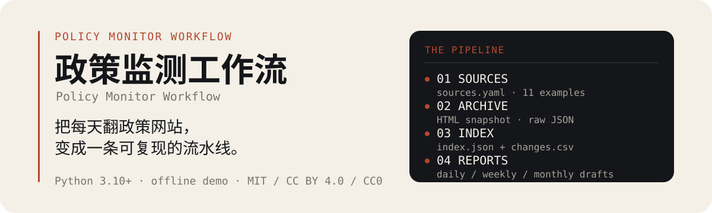
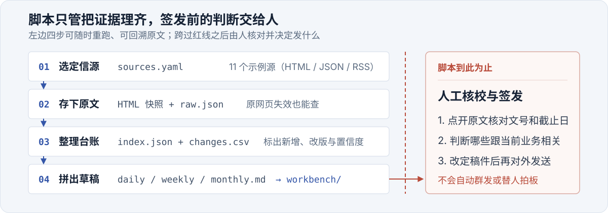

<p align="center">
  
</p>

# 政策监测 Workflow

**把每天翻政策网站，变成一条可复现的流水线。**

先接信源、存原文，再做索引、变更和报告草稿。脚本只做机械工作；相关性判断、优先级取舍和对外签发，留给人。

`Python 3.10+` · `离线 demo` · `MIT / CC BY 4.0 / CC0`

## 30 秒看到结果

不需要安装依赖，不需要联网：

```bash
python scripts/run_pipeline.py --demo
```

demo 会从 4 个本地 HTML 快照里采出 **8 条虚构条目**，生成：

```text
examples/outputs/
├── index.json          # 稳定读模型：标题、层级、类型、日期、摘要
├── changes.csv         # 新增 / 更新 / 移除流水，Excel 可直接打开
├── daily/2026-11-12.md # 1 页日报草稿
├── weekly/2026-W46.md  # 3–5 条信号 + 截止日历
├── monthly/2026-11.md  # 趋势 + 增量 + 下月建议
└── workbench/          # 可直接接工作台的数据包
```

> demo 数据固定在 2026 年 11 月，所有人都能跑出同一份结果。换日期：`--date 2026-11-13`。

## 它解决的不是“抓取”，是“可复现”

| 以前 | 现在 |
|---|---|
| 收藏夹里一堆链接，过两周就失效 | 信源 YAML + 原始 HTML 快照 |
| 周报从零开始回忆“这周发生了什么” | 索引 + 变更流水 + 报告草稿 |
| 只记得“好像发过”，找不到原文 | 每条都有 `source_url`、`content_hash`、`review.required` |
| 抓到什么算什么 | 字段抽取带来源、置信度和 warnings |

它**不是**政策数据库、不是自动签发系统、不是爬虫框架，也不替代原文。它只把“采集 → 存档 → 索引 → 变更 → 草稿”这一段做得可重复、可检查。

## 一条流水线，四个停点

<p align="center">
  
</p>

- **01 信源**：`sources/sources.example.yaml` 里有 11 个虚构源，覆盖 HTML、JSON、RSS、人工源。
- **02 采集与存档**：列表、详情、原始 HTML、`raw.json`、`health.csv`；失败也留痕。
- **03 解析与索引**：抽标题、正文、日期、文号、机构、截止日期；生成 `index.json` 和 `changes.csv`。
- **04 报告草稿**：日报 1 页、周报 3–5 条信号、月报趋势 + 增量 + 建议。

**脚本停在这里。** 之后是人工复核、判断和签发；AI 只在草稿阶段做初判，不自动对外发布。

## 输出长什么样

`index.json` 是给人和工作台读的稳定读模型，正文在 `items/` 里：

```json
{
  "doc_id": "CITY-2026-57699d4f",
  "title": "关于组织开展2026年度示例市智能工厂梯度培育申报工作的通知",
  "level": "市级部门",
  "type": "申报",
  "publish_date": "2026-11-09",
  "deadline": "2026-12-05",
  "status": "待研判",
  "summary": "为加快推动制造业数字化转型……",
  "source_url": "https://jxj.example.gov.cn/...",
  "content_path": "examples/items/CITY-2026-57699d4f.json",
  "review": { "required": true, "reasons": ["核对申报对象、材料清单与截止时间"] }
}
```

- `doc_id` 稳定：同一 URL 重跑不会变。
- `review.required` 永远为 `true`：脚本不替人做相关性判断。
- `changes.csv` 一行一次变化，带 UTF-8 BOM；适合做“本周新增/更新”时间线。
- 三份报告都是 Markdown 草稿，可以直接复制到文档里改。

## 接到你的工作台

输出特意按“壳读取”设计。跑完 demo 后：

```bash
python scripts/export_workbench.py
```

会生成 `examples/outputs/workbench/`：`index.json`、`annotations.json`、`reports.json` 和 `items/<id>/content.md`。把它复制到 [agent-workbench-template](https://github.com/Fanghj256/agent-workbench-template) 的 `workbench/`，或让工作台把数据目录指向这里。

工作台只读生成物；人的判断写到覆盖层，不直接改 `index.json`。完整映射见 [docs/workflow.md](docs/workflow.md)。

## 换成你的领域

- **换信源**：复制 `sources/sources.example.yaml` 为 `sources.local.yaml`，填 URL、选择器和关键词。
- **换主题词**：改 `taxonomy`，只影响条目的主题标签，不影响是否抓取。
- **换报告**：改 `templates/*.md` 的章节和文案；`report.py` 只替换占位符。
- **换节奏**：日报/周报/月报的窗口在 `report.py` 的 `select_items`。

live 模式（需要 `requests` + `PyYAML`）：

```bash
cp sources/sources.example.yaml sources/sources.local.yaml
python -m pip install -r requirements.txt
python scripts/run_pipeline.py --config sources/sources.local.yaml
```

加一个源的最小步骤、选择器写法、健康检查和常见坑，见 [docs/sources.md](docs/sources.md)。完整数据契约见 [docs/architecture.md](docs/architecture.md)。

## 限制

- demo 是冻结的虚构数据，不代表任何真实政策或趋势。
- live 选择器要按站点维护；页面改版、JS 渲染、登录、验证码、PDF/OCR 都不在默认范围内。
- 日期、文号、截止日期是启发式抽取；报告里的每条都应回原文核验。
- 没有数据库；`index.json` 适合几千条以内的个人/小团队监测，更大规模建议换 SQLite/Postgres，字段契约不变。
- 不包含调度、发布、权限和审计；这些交给工作台或你的现有系统。

## 安全与许可

- 安全策略、凭据处理、日志与数据保留：见 [SECURITY.md](SECURITY.md)。
- 代码：MIT，见 [LICENSE](LICENSE)。
- 文档、提示词、模板：CC BY 4.0，见 [LICENSE-docs](LICENSE-docs)。
- 示例数据：CC0，见 [LICENSE-data](LICENSE-data)。
- 真实信源页面的版权归原站点所有；采集和再利用前请确认站点条款、robots 约定和当地法律。

---

*English: a local-first, source-first policy monitoring workflow. It fetches public listings, archives originals, builds an index and change log, and renders daily, weekly and monthly drafts. The demo is offline, uses fictional data, and needs only the Python standard library.*

