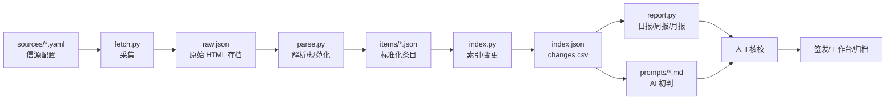

# 架构：从信源到报告

这篇文档讲清楚三件事：

1. 数据在每一步长什么样；
2. 为什么顺序是「先信源、再存档、再输出」；
3. 哪些事情脚本故意不做。

## 一、总览



对应的目录：

```text
sources/                 配置：监测谁、抓哪里、用什么选择器
data/raw/                采集物：raw.json + html/ + health.csv
data/items/              条目库：一条政策一个 JSON
outputs/                 读模型：index.json + changes.csv + 报告草稿
examples/                离线 demo：假 HTML + 假条目 + 示例输出
```

demo 把 `data/` 换成 `data/demo/`，把 `outputs/` 换成 `examples/outputs/`，把 `data/items/` 换成 `examples/items/`。代码路径完全一样。

如果目标工作台使用 [agent-workbench-template](https://github.com/Fanghj256/agent-workbench-template) 的数据合同，运行 `python scripts/export_workbench.py` 会把 `index.json`、条目正文和报告投影成 `workbench/` 数据包；导出时会把内部的 `level/type/status` 映射到工作台筛选器的受控词表，无法映射的 `type` 落到 `原文` 并写入该条的 `warnings`。这是可选的展示层，不影响上游六段流水线。

## 二、六个阶段

### 1. 信源配置（sources）

信源是唯一的手工入口。一条源至少要有：

```yaml
- id: demo-city-gov
  name: 示例市人民政府
  enabled: true
  type: html
  level: 市级
  department: 示例市人民政府办公室
  source_tier: L1
  list_url: https://www.example.gov.cn/zhengce/
  link_pattern: '^/zhengce/\d{4}/\d{2}/\d{2}/'
```

为什么先做配置而不是先写抓取：**监测质量的上限由信源决定**。源选错了，后面的摘要、报告、AI 都只是在放大噪声。配置把「监测范围」变成可审查的清单，而不是散落在脚本里的 URL。

### 2. 采集（fetch）

输入：信源配置。  
输出：`raw.json`、`data/raw/html/<record_id>.html`、`health.csv`。

`raw.json` 的记录结构：

```json
{
  "record_id": "rec-a1b2c3d4e5f6",
  "source_id": "demo-city-gov",
  "source_name": "示例市人民政府",
  "source_tier": "L1",
  "level": "市级",
  "department": "示例市人民政府办公室",
  "signal": "政策",
  "list_url": "https://www.example.gov.cn/zhengce/",
  "url": "https://www.example.gov.cn/zhengce/2026/11/09/item-001.html",
  "title_hint": "……",
  "date_hint": "2026-11-09",
  "summary_hint": "……",
  "first_seen_hint": "2026-11-09",
  "fetched_at": "2026-11-12T18:00:00+08:00",
  "html": "",
  "html_path": "data/raw/html/rec-a1b2c3d4e5f6.html",
  "extract": {
    "body_selector": ".article-body",
    "date_selector": ".meta .publish-date",
    "doc_no_selector": ".meta .doc-number"
  }
}
```

关键设计：

- **原始 HTML 单独存档**，不塞进条目库。条目库可以重建，原始页面不能。
- **列表信息只是 hint**。标题、日期、摘要都以详情页为准；详情抓失败时，hint 让条目仍然可读。
- **每个源独立失败**。一个源报错不会中断其他源；`health.csv` 记录成功/空/失败。
- **不在采集阶段做关键词判断以外的筛选**。标题关键词只用来减少无关条目；相关性判断留给人。

### 3. 解析（parse）

输入：`raw.json` + HTML。  
输出：`items/<doc_id>.json`。

条目结构（节选）：

```json
{
  "schema_version": "1.0",
  "doc_id": "CITY-2026-57699d4f",
  "title": "关于组织开展2026年度示例市智能工厂梯度培育申报工作的通知",
  "issuer": "示例市经济和信息化局",
  "doc_number": "示例经信〔2026〕42号",
  "level": "市级部门",
  "type": "申报",
  "subtype": "申报通知",
  "themes": ["智能制造"],
  "publish_date": "2026-11-09",
  "effective_date": "",
  "deadline": "2026-12-05",
  "deadlines": [{"date": "2026-12-05", "context": "……"}],
  "status": "待研判",
  "priority": 5,
  "priority_reason": "申报类；市级部门",
  "summary": "……",
  "body": "……",
  "source_url": "……",
  "source": {"name": "示例市经济和信息化局", "tier": "L1", "level": "市级部门"},
  "first_seen": "2026-11-09",
  "last_updated": "2026-11-12",
  "content_hash": "……",
  "extraction": {
    "date_source": "选择器",
    "doc_number_source": "选择器",
    "confidence": "高",
    "warnings": []
  },
  "review": {
    "required": true,
    "reasons": ["核对申报对象、材料清单与截止时间"],
    "checked_by": "",
    "decision": ""
  }
}
```

解析阶段的四条规则：

1. **字段可追溯**。每个关键字段都记录来源（选择器 / meta / 正文规则 / 列表 hint），出错时知道该改哪里。
2. **不确定就留空 + warning**。不猜文号，不猜日期，不把「2026年12月1日起施行」当成发布日期。
3. **摘要是抽取式的**。取原文前几句，不改写；AI 摘要在后面的提示词阶段，且必须标注为初判。
4. **保留人工字段**。重跑解析时，`status`、`owner`、`tags`、`notes`、`review.checked_*` 从旧条目继承。

### 4. 索引（index）

输入：`items/*.json`。  
输出：`index.json`、`changes.csv`。

`index.json` 是读模型，不是全量库：

- 只放列表/筛选/排序需要的字段；
- 正文留在 `content_path` 指向的条目 JSON；
- `stats` 预聚合层级、类型、主题、来源、置信度；
- 每条带 `change`：`added / updated / unchanged / removed`。

变更检测：

```text
旧 index 里有、新条目没有  -> removed
旧 index 里没有、新条目有  -> added
两边都有，关键字段变了      -> updated
两边都有，关键字段没变      -> unchanged
```

比较字段包括标题、机构、文号、层级、类型、发布日期、截止、状态、摘要、优先级、正文哈希。`last_updated` 和解析时间不参与比较，否则每次跑都会「更新」。

为什么用 `index.json` 而不是数据库：

- 人和工作台都能直接读；
- diff 友好，适合 Git 管理小规模监测；
- 几千条以内性能足够；
- 真要上规模，字段契约不变，换 SQLite/Postgres 即可。

### 5. 报告（report）

输入：`index.json` + `templates/*.md`。  
输出：`daily/YYYY-MM-DD.md`、`weekly/YYYY-Www.md`、`monthly/YYYY-MM.md`。

报告只做四件事：

- **选择窗口**：日报按首次发现日期；周报/月报按发布日期。
- **机械排序**：类型权重 + 层级 + 截止时间，得到 1–5 的 `priority`。
- **填模板**：概览、表格、截止提醒、来源覆盖。
- **标注不确定性**：草稿、抽取式摘要、待人工核验。

报告不写「这条政策对我司有什么影响」，也不写「建议跟进」之外的行动结论。那些内容属于 `prompts/` 的 AI 初判和人的签发。

### 6. 初判与签发（prompts + 人）

AI 的位置：

```text
index.json / items
      ↓
prompts/daily.md、weekly.md、monthly.md
      ↓
AI 初判草稿（事实、疑点、待核验问题、候选信号）
      ↓
人：回原文、判断适用性、改写、签发
```

AI 不接触采集和索引，避免「模型编造一条政策」进入数据层。提示词要求：

- 只使用输入里的条目；
- 事实和推断分开；
- 不编造日期、文号、截止；
- 不确定写「待核」；
- 输出是草稿，不是结论。

## 三、为什么是这个顺序

### 先信源，后输出

报告是结果，信源是因果。先有稳定的源清单、健康检查和失败记录，报告才可复现。反过来，先做漂亮模板，最后发现源不全，只能反复返工。

### 先存档，再加工

政策页面会改、会删、会迁移。条目 JSON 是加工品，HTML 是证据。存档让「当时原文是什么」可回查，也让解析器改规则后可以重跑。

### 脚本只做机械工作

机械工作可测试、可复现、可审计：

- 抓取：HTTP 请求、HTML 保存；
- 解析：选择器、正则、字段映射；
- 索引：排序、去重、变更比对；
- 报告：模板替换。

判断工作不可外包给脚本：

- 这条政策是否适用于我们的业务？
- 影响是直接还是间接？
- 值不值得跟进？
- 对外怎么说？

把两类工作混在一起，最后既无法验证数据，也无法追责判断。

### AI 只做初判

AI 擅长压缩、改写、列问题；不擅长保证事实。把它放在「草稿」层，人可以快速删改；放在「数据」层，错误会污染索引和报告。

## 四、失败模式与降级

| 失败 | 表现 | 处理 |
|---|---|---|
| 列表页改版 | `fetch` 返回 0 条 / 选择器不命中 | 看 `health.csv`；更新 `link_pattern` 或选择器 |
| 详情页超时 | 条目只有标题和列表摘要 | `warnings` 标注；稍后补采或人工打开 |
| 日期在正文图片里 | 发布日期为空 | 报告退回 `first_seen`；人工补日期 |
| 文号来自引用文件 | 文号明显不属于本文 | `doc_no_selector` 精确取；人工改条目 |
| 源被墙/需要登录 | 连续失败 | 标为 `manual`，人工转发；不绕过 |
| 条目重复 | 同一 URL 多次出现 | `doc_id` 基于 URL，天然去重 |
| 索引误报 removed | 条目目录传入了子集 | 保持「items 是库，不是批次」；或 `--no-removals` |
| 模板缺占位符 | 成品缺段 | `report.py` 会清掉未替换占位符；检查模板键名 |

降级原则：**宁可少一条，不要错一条**。字段缺失可以补，错误字段会误导判断。

## 五、安全边界

- 只抓公开页面；不提交表单、不登录、不绕过验证码/付费墙。
- TLS 校验保持开启；不提供「忽略证书错误」开关。
- 信源配置视为可信输入；不要加载来源不明的配置或脚本。
- 原始 HTML 可能含个人信息、联系方式、脚本；存档目录不进 Git，报告只放摘要和链接。
- 日志和 `health.csv` 可能含 URL、标题、错误片段；对外分享前先脱敏。
- 报告是 Markdown，标题来自外部页面；对外发布前检查链接和文本，避免注入。

## 六、扩展点

| 想扩展 | 改哪里 | 不用改哪里 |
|---|---|---|
| 新源类型（如 sitemap） | `fetch.py` 加一个 adapter | `parse/index/report` |
| 更复杂的 HTML | 换 BeautifulSoup/lxml，保持 raw 结构 | 数据契约 |
| 新字段（如附件列表） | `parse.py` 加字段；`index.py` 决定是否进读模型 | 报告模板可暂时忽略 |
| 新报告（如专题简报） | 新模板 + `report.py` 一个 render 函数 | 采集/解析 |
| 换存储 | 用 SQLite 实现 `index.py` 的读写 | 字段名和 `schema_version` |
| 接工作台 | 读 `index.json` / `changes.csv`；或用 `export_workbench.py` 导出 workbench 数据包 | 不需要 import 脚本 |

## 七、规模与演进

- **< 2,000 条**：当前 JSON 方案足够；一次索引在秒级。
- **2,000–20,000 条**：把 `items` 放 SQLite，`index.json` 仍可作为导出物；报告按窗口查询。
- **> 20,000 条**：需要分页、增量索引、全文检索；字段契约不变，换存储和查询层。
- **多用户**：增加 `overrides.json` 或数据库表，记录状态、负责人、核验结论；不要让人直接改生成物。

## 八、版本策略

- `schema_version` 当前为 `1.0`。
- 新增字段：小版本 +0.1，旧消费者忽略未知字段。
- 删除/改名字段：大版本 +1.0，同时提供迁移说明。
- `doc_id` 一旦生成不应改变；它是工作台、人工备注、变更流的主键。
